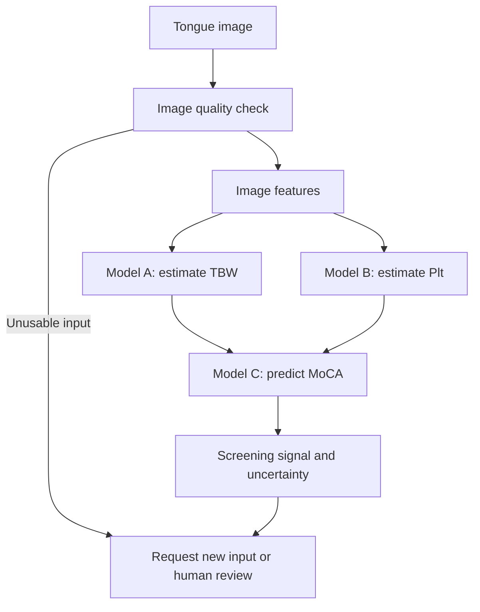

# Artificial Intelligence-Assisted Facial Medical Inspection

**From multimodal clinical research to an interpretable cognitive-screening application.**

[繁體中文](README.zh-TW.md) · [Research evidence](docs/research-evidence.md) · [Architecture and roadmap](docs/architecture-and-roadmap.md)

This project explores how physiological measurements and face/tongue images can support the study of cognitive function in people with chronic diseases. My work combines clinical data preparation, statistical modeling, machine learning, image preprocessing, and interpretation of predictive findings.

The long-term application is a **two-stage prediction system**: two models estimate **total body water (TBW)** and **platelet count (Plt)** from tongue images, and a third model combines those estimates to predict the **Montreal Cognitive Assessment (MoCA)** score. Causal analysis will examine the biological assumptions behind this integration. Agent-assisted workflows and edge-device deployment are planned extensions.

**Current status:** the repository contains reconstructed Python reference modules and project documentation. The integrated tongue-image → TBW/Plt → MoCA system, a fitted image-to-Plt model, causal-effect estimation for the new pathway, an agent, and Jetson deployment have **not yet been demonstrated here**. This is a research/portfolio project, not a validated clinical screening product.

## Project, thesis, and repository

| Work | Scope |
| --- | --- |
| **Artificial Intelligence-Assisted Facial Medical Inspection** | The broader clinical AI project, including multimodal data collection, image preprocessing, and physiological modeling in collaboration with National Taiwan University Hospital. |
| **Master's thesis — Physiological Predictors of Cognitive Functions in Patients with Chronic Diseases** | A branch of the broader project: tabular physiological/psychological predictors of MoCA, using best subset regression, Lasso, neural networks, SHAP, and exploratory mediation analysis. NTU, 2025. [Thesis DOI](https://doi.org/10.6342/NTU202503365). |
| **This repository** | A public engineering reconstruction and the development plan for integrating image-derived biomarkers, MoCA prediction, and human-review support.|
| **[multimodal-cognition-repro-2025](https://github.com/yutungamelie/multimodal-cognition-repro-2025)** | Companion research repository for thesis analyses and figure/table reproduction. Access may be restricted; its data and trained artifacts are not bundled here. |

The project name is **not** the thesis title. Research results below belong to the original study, not to the reconstructed public modules or the proposed three-model system.

## My contributions

- Collected and organized multimodal study data spanning physiological measurements, clinical records, questionnaires, cognitive assessments, and face/tongue imaging.
- Developed R/Python analyses for data preprocessing, feature exploration, MoCA regression, model comparison, and SHAP interpretation.
- Contributed tongue-image preprocessing and exploratory modeling of physiological targets from image features.
- Organized the application into reusable preprocessing, modeling, evaluation, and review-prioritization modules, and defined the next experiments for the two-stage system.

## Research at a glance

| Evidence | Result | What the result describes |
| --- | --- | --- |
| Study cohort | **110 participants recruited; 106 complete cases analyzed** | Recruitment and thesis modeling sample sizes are different denominators. |
| Tabular model comparison | **3 approaches** | Best subset regression, Lasso, and a neural network interpreted with SHAP. |
| Best subset regression | **13 selected predictors; adjusted R² = 0.3763** | Thesis Table 4.2; a model-fit statistic on the analysis sample, not held-out accuracy. |
| Neural-network architecture | **38 inputs → 32 hidden units → 1 output** | The reviewed tabular PyTorch implementation and selected thesis architecture; not an image encoder. |
| Predictor findings | **TBW and Plt motivate the proposed intermediate layer** | Plt appeared in the regression selections and among prominent SHAP features. TBW was selected by best subset regression and prominent in SHAP, but was excluded from the final Lasso selection. |

See [research evidence and interpretation limits](docs/research-evidence.md) for thesis-reported errors, mediation results, image-experiment provenance, and reproducibility work. No clinical performance or latency result is claimed for the proposed integrated system.

## Proposed application architecture

**Planned architecture — these arrows describe computation, not established causation.**

The first experiment is to establish a new **measured TBW + measured Plt → MoCA** baseline. The next step is to compare it with image-derived estimates on the same held-out participants. The thesis's 13-feature result cannot be transferred to this new two-input model.

The two biomarkers form an interpretable intermediate representation, similar to a [concept bottleneck model](https://proceedings.mlr.press/v119/koh20a.html). Whether they have causal effects on cognition is a separate research question. The new causal model will consider common causes and measurement error; it is not required to reuse the thesis's age-mediation formulation.

## What is currently in the code

| Area | Existing modules | Status |
| --- | --- | --- |
| Tabular preparation | [Cleaning](src/data_preprocessing/tabular_cleaning.py), [variable filtering](src/data_preprocessing/variable_filtering.py), [correlation grouping](src/data_preprocessing/correlation_grouping.py) | Reconstructed reference utilities. |
| Image preparation | [Face crop checks](src/image_preprocessing/face_crop_quality_check.py), [tongue preprocessing](src/image_preprocessing/tongue_image_preprocessing.py), [lighting metadata](src/image_preprocessing/lighting_metadata_parser.py) | Crop/resize/normalization and quality heuristics; tongue input defaults to 3 × 128 × 128. |
| Image representation | [Image feature extraction](src/modeling/image_feature_extraction.py) | **PCA/IncrementalPCA mock encoders**, not the original trained autoencoders. |
| Predictive models | [Physiological targets](src/modeling/physiological_target_prediction.py), [tabular MoCA](src/modeling/tabular_moca_prediction.py) | Generic scikit-learn modeling modules; no fitted clinical weights or integrated TBW/Plt bottleneck model. |
| Reliability analysis | [Bootstrap](src/evaluation/bootstrap_ci.py), [model agreement](src/evaluation/model_agreement_check.py), [error analysis](src/evaluation/error_analysis.py) | Reference analysis utilities. Bootstrap refits describe variation in fitted predictions, not validated individual prediction intervals. |
| Review support | [Score mapping](src/review_prioritization/cognitive_risk_score.py), [uncertainty rules](src/review_prioritization/uncertainty_score.py), [review rules](src/review_prioritization/review_prioritization_rule.py) | Demo rules and heuristic flags; neither calibrated disease probabilities nor a clinical protocol. |

The current repository does not include a packaged end-to-end quickstart, an environment lock file, patient data, trained clinical models, a UI, or an inference API. Code examples that reference external CSV/image files require separately supplied inputs. Known execution and evaluation gaps are listed in the [first development milestone](docs/architecture-and-roadmap.md#milestone-0--reproducible-reference-modules).

## Next development milestones

1. Make the reference modules reproducible with synthetic fixtures, explicit dependencies, and transparent evaluation results.
2. Evaluate measured and image-estimated TBW/Plt models with participant-level splits, fold-specific preprocessing, and out-of-fold training inputs for the prediction stack.
3. Define a causal estimand and candidate graph; assess common-cause and measurement-error assumptions before interpreting effects.
4. Export versioned models with feature order, units, preprocessing parameters, and MoCA output-scale restoration; serve predictions through a documented API.
5. Benchmark desktop and Jetson inference, then add an agent that calls validated tools and summarizes their structured outputs.

The [architecture and roadmap](docs/architecture-and-roadmap.md) records acceptance criteria and metrics for each milestone. Agent frameworks, APIs, Docker, ONNX/TensorRT, and Jetson hardware are development candidates, not implemented capabilities in this repository.

## Data and use

No participant records, clinical images, or trained clinical artifacts are distributed here. Future public demonstrations will use synthetic data and will label their results as synthetic. Research findings are exploratory and require further validation before use in patient care.

The reconstructed code is available under the [MIT License](LICENSE). It does not grant access or rights to patient data, the thesis, hospital materials, or other third-party assets.
