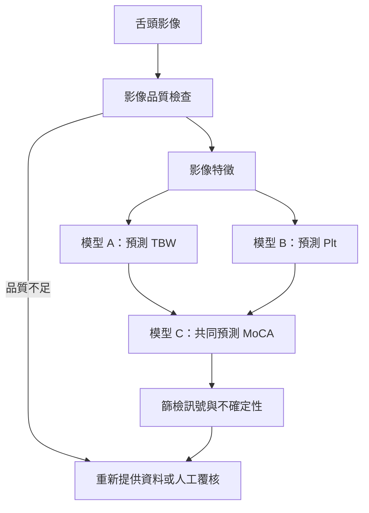

# Artificial Intelligence-Assisted Facial Medical Inspection

**從多模態臨床研究，延伸至可解釋的認知功能篩檢應用。**

[English](README.md) · [研究證據](docs/research-evidence.md) · [架構與開發路線](docs/architecture-and-roadmap.md)

本專案探討如何結合生理測量、臉部／舌頭影像與統計建模，研究慢性疾病患者的認知功能。我的工作涵蓋資料蒐集與整理、R／Python 分析、模型比較、影像前處理及結果解釋。

長期目標是建立兩階段預測系統：先以舌像分別估計**總體水分（TBW）**與**血小板數量（Plt）**，再把兩個預測值共同輸入第三個模型，預測**蒙特婁認知評估（MoCA）分數**。因果分析將用來研究這項整合背後的生理假設；Agent 與邊緣裝置部署是後續開發方向。

**目前進度：**本儲存庫已有重建的 Python 參考模組與專案文件；尚未在此完成舌像 → TBW／Plt → MoCA 的整合驗證，也未提供已訓練的舌像 Plt 模型、新路徑的因果效果估計、Agent 或 Jetson 部署成果。本專案目前是研究與作品集用途，尚非經臨床驗證的篩檢產品。

## 計畫、論文與儲存庫的關係

| 項目 | 範圍 |
| --- | --- |
| **Artificial Intelligence-Assisted Facial Medical Inspection** | 整體臨床 AI 計畫，包含與臺大醫院合作的多模態資料蒐集、影像前處理及生理指標建模。 |
| **碩士論文：慢性疾病患者認知功能之生理指標預測** | 從整體計畫延伸出的分支，以表格資料探討生理／心理指標與 MoCA；使用 best subset regression、Lasso、神經網路、SHAP 與探索性中介分析。臺灣大學，2025。[論文 DOI](https://doi.org/10.6342/NTU202503365)。 |
| **本儲存庫** | 公開的工程重建版本，以及未來整合影像、生理指標、MoCA 預測與人工覆核的開發計畫。 |
| **[multimodal-cognition-repro-2025](https://github.com/yutungamelie/multimodal-cognition-repro-2025)** | 論文分析及圖表重現的相關研究儲存庫；存取可能受限，資料與訓練成果未包含於此。 |

計畫名稱與論文題目不同。下列研究數字來自原研究，不是公開展示模組或未來三模型系統的成績。

## 我的主要工作

- 蒐集與整理生理測量、臨床紀錄、問卷、認知評估及臉部／舌頭影像等多模態研究資料。
- 建立 R／Python 資料處理、特徵探索、MoCA 迴歸、模型比較與 SHAP 解釋流程。
- 參與舌頭影像前處理，以及由影像特徵預測生理指標的探索性實驗。
- 將作品集整理成資料處理、建模、評估與人工覆核模組，並規劃兩階段模型的驗證方式。

## 研究成果摘要

| 項目 | 已有研究結果 | 解讀範圍 |
| --- | --- | --- |
| 研究樣本 | **110 人收案；106 個完整個案進入分析** | 收案數與模型分析數不同。 |
| 模型比較 | **3 種方法** | Best subset regression、Lasso、搭配 SHAP 解釋的神經網路。 |
| 最佳子集迴歸 | **13 個預測變數；adjusted R² = 0.3763** | 論文 Table 4.2 的樣本內模型擬合結果，不能當成未見資料的準確率。 |
| 表格神經網路 | **38 個輸入 → 32 個隱藏神經元 → 1 個輸出** | 根據研究程式與論文選定架構；這不是影像 encoder。 |
| 生理指標 | **TBW 與 Plt 為後續整合的候選指標** | Plt 出現在迴歸選模與重要 SHAP 特徵中；TBW 在 best subset 與 SHAP 中重要，但未保留於最終 Lasso。 |

完整的論文誤差、中介分析、影像實驗來源與重現限制，請見[研究證據](docs/research-evidence.md)。目前沒有整合系統的臨床效能或裝置延遲數據。

## 規劃中的應用架構

以下表示**預計實作的計算流程**，不是已證實的因果關係。

第一個實驗是重新建立「實測 TBW＋實測 Plt → MoCA」基準，再用相同的未見受試者比較影像估計版本。原論文的 13 變數成果不能直接套用到這個兩輸入模型。

這種中間層接近 concept bottleneck model，可提供生理指標層級的解釋。因果研究則另外檢視共同原因、量測誤差與生理機制，不必沿用原論文的年齡中介模型。

## 程式現況

| 目錄 | 現有內容 |
| --- | --- |
| [src/data_preprocessing](src/data_preprocessing) | 表格清理、變數篩選、相關性分群。 |
| [src/image_preprocessing](src/image_preprocessing) | 臉部裁切檢查、舌像裁切／縮放／正規化、光線 metadata 解析。 |
| [src/modeling](src/modeling) | PCA／IncrementalPCA 模擬 encoder、生理指標預測及表格 MoCA 模型；未提供原始 autoencoder 或臨床模型權重。 |
| [src/evaluation](src/evaluation) | Bootstrap 重訓、模型一致性與誤差分析；目前沒有經驗證的個人預測區間涵蓋率。 |
| [src/review_prioritization](src/review_prioritization) | 展示用分級、啟發式不確定性與覆核規則，不是疾病機率或臨床處置規範。 |

目前尚未附上可直接執行的完整示範、環境鎖定檔、訓練資料、臨床模型權重、UI 或推論 API。部分程式仍需修正執行與評估問題；具體項目列於[開發里程碑](docs/architecture-and-roadmap.md#milestone-0--reproducible-reference-modules)。

## 下一步

1. 補齊參考模組的合成測試資料、相依套件與評估紀錄，修正重現問題。
2. 驗證實測與影像估計的 TBW／Plt 模型；以受試者分組切分，在各訓練 fold 內處理資料，並以 OOF 預測訓練下游模型。
3. 定義新的因果估計目標與候選因果圖，分析共同原因及量測誤差。
4. 匯出模型、特徵順序、單位與標準化參數，還原 MoCA 原始尺度，建立有版本的推論介面。
5. 量測桌機與 Jetson 的推論效能，再加入呼叫工具、整理結果的 Agent 流程。

API、Docker、Agent、ONNX／TensorRT 與 Jetson 目前均為開發候選方案，不列為已完成的實作成果。

## 資料與使用範圍

本儲存庫不提供個案資料、臨床影像或臨床模型權重。未來公開示範將使用合成資料，並標明結果來自合成測試。研究發現仍屬探索性，實際病人照護用途需要進一步驗證。

重建程式採用 [MIT License](LICENSE)；授權不包含病人資料、論文、醫院文件或第三方素材。
